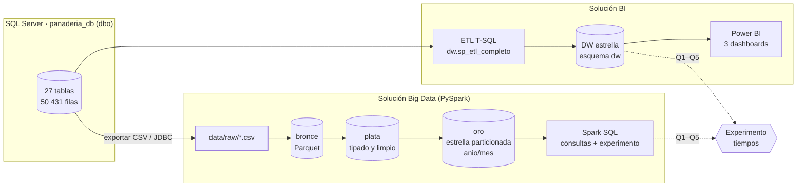

# Panadería Chapala · Solución BI y Big Data
Repositorio oficial del proyecto del curso Base de Datos Avanzadas y Big Data (UPN).
# Panadería Chapala · Solución BI y Big Data

Proyecto del curso **Base de Datos Avanzadas y Big Data (UPN)**. El repositorio contiene dos soluciones sobre los
mismos datos de la Panadería Chapala (ventas, producción, compras e inventario, enero a septiembre de 2026), además de
un experimento que compara sus tiempos de consulta:

| Solución | Tecnología | Resultado |
|---|---|---|
| **BI** | SQL Server (OLTP + data warehouse en estrella) · ETL en T-SQL · Power BI | 3 dashboards: Ventas, Producción y merma, Inventario y compras |
| **Big Data** | PySpark 3.5 · Parquet por capas (bronce/plata/oro) · Spark SQL · Airflow | Lago de datos particionado por año/mes, controles de calidad y consultas |
| **Experimento** | Q1–Q5 en SQL Server y en Spark con x1, x10 y x50 filas | `experimento/resultados/` + gráfico comparativo |

## Arquitectura



## Estructura del repositorio

```
panaderia-chapala-bi-bigdata/
├── README.md                      este archivo
├── LICENSE                        MIT
├── requirements.txt               dependencias Python (Big Data + análisis)
├── data/raw/                      13 CSV exportados de SQL Server (fuente de la ingesta Big Data)
├── bi/
│   ├── sql/
│   │   ├── 01_crear_bd_oltp.sql         crea panaderia_db con sus 27 tablas y datos (convertido de MariaDB)
│   │   ├── 02_dw_ddl.sql                esquema dw: 5 dimensiones, 4 hechos, bitácora ETL
│   │   ├── 03_dw_etl.sql                procedimientos ETL (MERGE de dimensiones, recarga de hechos)
│   │   ├── 04_pruebas_oltp.sql          ~50 consultas de prueba sobre la base transaccional
│   │   ├── 05_consultas_dw.sql          consultas analíticas y conciliación OLTP vs DW
│   │   └── 06_experimento_sqlserver.sql experimento de tiempos (x1, x10, x50)
│   └── powerbi/
│       ├── Panaderia_Dashboards/        proyecto Power BI (.pbip) conectado al esquema dw
│       ├── gen_pbip.py                  utilidades del generador del proyecto
│       └── gen_pbip_dw.py               generador del proyecto Power BI (modelo + 3 páginas)
├── bigdata/
│   ├── run_pipeline.py            orquestador local (CLI) de las 5 etapas
│   ├── config/
│   │   ├── pipeline.json          rutas, Spark, ingesta, particionamiento, experimento
│   │   └── spark-defaults.conf    misma configuración para spark-submit / clúster
│   ├── src/
│   │   ├── comun.py               sesión Spark, logging y métricas (logs/metricas.jsonl)
│   │   ├── ingesta.py             CSV o JDBC -> bronce
│   │   ├── transformacion.py      bronce -> plata -> oro (modelo estrella)
│   │   ├── calidad.py             controles de calidad (CRITICO / AVISO)
│   │   ├── consultas.py           consultas Spark SQL (Q1–Q5 + negocio)
│   │   └── experimento.py         tiempos con factores de escala
│   ├── orquestacion/airflow_dag_panaderia.py   DAG diario + DAG del experimento
│   ├── notebooks/Panaderia_BigData_Colab.ipynb cuaderno ejecutable en Google Colab
│   └── docker/docker-compose.yml  entorno Spark + Jupyter reproducible
├── experimento/
│   ├── analizar_resultados.py     compara plataformas, genera tabla y gráfico
│   └── resultados/                CSV de tiempos (SQL Server y Spark) y resumen
└── evidencias/                    capturas y archivos de prueba (ver evidencias/README.md)
```

## Requisitos y licencias

| Componente | Versión probada / mínima | Licencia | Uso |
|---|---|---|---|
| SQL Server (Developer o Express) | 2016 SP1 o superior | Propietaria, gratuita (Microsoft) | OLTP, DW, experimento |
| SQL Server Management Studio | 19+ | Propietaria, gratuita | Ejecutar scripts `bi/sql` |
| Power BI Desktop | 2025 o superior (formato PBIP/PBIR) | Propietaria, gratuita | Dashboards |
| Python | 3.10+ | PSF | Pipeline Big Data |
| Java (JDK/JRE) | 11 o 17 | GPL v2 + Classpath (OpenJDK) | Requerido por Spark |
| Apache Spark / PySpark | 3.5.3 | Apache 2.0 | Procesamiento distribuido |
| pandas, pyarrow, matplotlib, tabulate | ver `requirements.txt` | BSD / Apache 2.0 / PSF / MIT | Análisis del experimento |
| Apache Airflow (opcional) | 2.7+ | Apache 2.0 | Orquestación programada |
| Docker (opcional) | 24+ | Apache 2.0 | Entorno Spark reproducible |
| Driver JDBC de SQL Server (opcional) | mssql-jdbc 12.6.1 | MIT | Ingesta directa (`--modo jdbc`) |

El código de este repositorio se distribuye con licencia **MIT** (ver `LICENSE`). Los datos son de uso académico.

## Reproducir la solución BI

1. En SSMS, abrir y ejecutar (F5), en este orden:
   1. `bi/sql/01_crear_bd_oltp.sql` (crea `panaderia_db`; por su tamaño conviene usar
      `sqlcmd -S localhost -E -i bi\sql\01_crear_bd_oltp.sql`).
   2. `bi/sql/02_dw_ddl.sql` (crea el esquema `dw`).
   3. `bi/sql/03_dw_etl.sql` (crea los procedimientos y ejecuta `dw.sp_etl_completo`).
2. Validar con `bi/sql/05_consultas_dw.sql`. Valores esperados:
   - Filas: `fact_ventas` 16 075, `fact_produccion` 826, `fact_compras` 124, `fact_consumo_insumos` 3 371, `dim_fecha` 365.
   - Ventas pagadas en el DW: **S/ 190 289.42** en **7 813** tickets.
3. Abrir `bi/powerbi/Panaderia_Dashboards/Panaderia_Dashboards.pbip` con Power BI Desktop. Si el servidor no es
   `localhost`, cambiarlo en *Transformar datos → Editar parámetros → ServidorSQL*. Pulsar **Actualizar**.
4. Valores esperados en el dashboard (sin filtros): Ventas totales S/ 190 289.42 · Nro ventas 7 813 ·
   Ticket promedio S/ 24.36 · Unidades 110 327 · % anulación 2.1 % · Órdenes 825 · % merma 12.5 % ·
   Compras S/ 55 263.06 (27 compras, 4 proveedores) · 6 productos con stock negativo.

## Reproducir la solución Big Data

**Opción A · Google Colab (recomendada, sin instalar nada):** abrir
`bigdata/notebooks/Panaderia_BigData_Colab.ipynb` en Colab, poner la URL del repositorio en la primera celda y
ejecutar todo.

**Opción B · Docker:**
```bash
docker compose -f bigdata/docker/docker-compose.yml up -d
docker compose -f bigdata/docker/docker-compose.yml exec spark pip install -r requirements.txt
docker compose -f bigdata/docker/docker-compose.yml exec spark python bigdata/run_pipeline.py
```

**Opción C · Local (Linux, macOS o WSL)** con Java 11/17 instalado:
```bash
python -m venv .venv && source .venv/bin/activate
pip install -r requirements.txt
python bigdata/run_pipeline.py                         # las 5 etapas
python bigdata/run_pipeline.py --etapas consultas      # solo una etapa
python bigdata/run_pipeline.py --modo jdbc             # ingesta directa desde SQL Server
```
En Windows nativo, Spark necesita además `winutils.exe` y la variable `HADOOP_HOME` para escribir Parquet;
por eso se recomiendan Colab, Docker o WSL.

Salidas: `datalake/{bronze,silver,gold}` (Parquet), `bigdata/salidas/*.csv` (resultados de consultas),
`logs/pipeline_*.log`, `logs/metricas.jsonl`, `logs/calidad_*.json` y `logs/spark-events/` (historial de Spark).

Valores esperados: `fact_ventas` 16 075 filas en 9 particiones `anio=2026/mes=1..9`; calidad sin errores críticos
y con 3 avisos conocidos del origen (6 ventas cuyo total no cuadra con sus líneas, 6 variantes con stock negativo
y 9 ventas sin número de comprobante; 0 comprobantes duplicados); Q1 con 9 filas (abril S/ 30 162.04, mayo S/ 33 116.81, …).

## Reproducir el experimento

1. SQL Server: ejecutar `bi/sql/06_experimento_sqlserver.sql` y exportar el último resultado a
   `experimento/resultados/sqlserver_resultados.csv`.
2. Spark: `python bigdata/run_pipeline.py --etapas experimento` (genera `experimento/resultados/spark_resultados.csv`).
3. Comparar: `python experimento/analizar_resultados.py` → `resumen_experimento.csv`, `resumen_experimento.md` y
   `tiempos_por_consulta.png`.

Diseño: 5 consultas (Q1 ventas por mes, Q2 top 10 productos, Q3 método de pago × día, Q4 ticket por tipo de
cliente, Q5 top 3 horas por mes con `RANK`), 3 factores de escala (16 075, 160 750 y 803 750 filas),
1 ejecución de calentamiento + 3 medidas por combinación. Ambas plataformas deben devolver el mismo número de
filas por consulta (9, 10, 35, 3 y 23 con x1).

## Versionado

| Dato | Valor |
|---|---|
| Rama | `main` |
| Etiqueta final | `v1.0-final` |
| Commit | ver `git log -1` (se reporta en el Capítulo V del informe) |

```bash
git clone --branch v1.0-final https://github.com/<usuario>/panaderia-chapala-bi-bigdata.git
```
